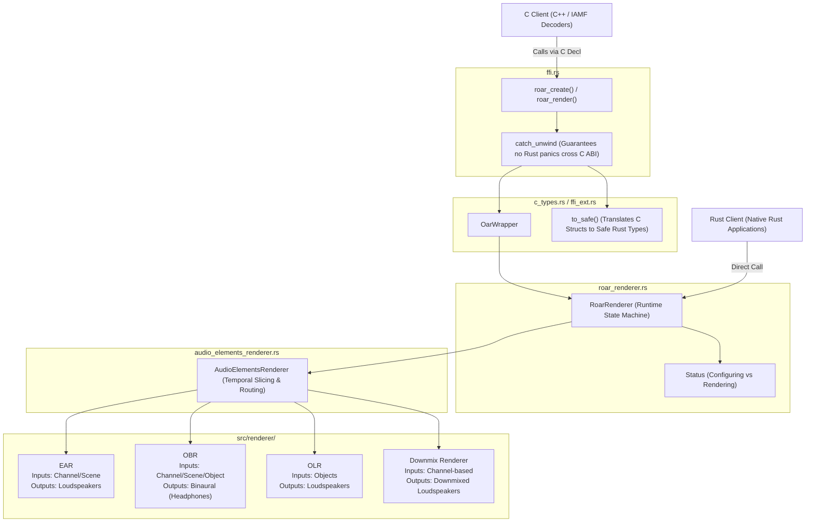

# ROAR (Rust Open Audio Renderer)

A Rust port of [Open Audio Renderer](https://github.com/AOMediaCodec/oar), the
reference implementation of the OAR specification.

The library can be used to render various types of input audio into a
loudspeaker or binaural output.

## Building and using in a Bazel C++ project

### Prerequisites

-   Install [bazelisk](https://bazel.build/install/bazelisk) to run and manage
    Bazel.

### Build

```shell
bazelisk build include:roar
```

### Run tests

```shell
bazelisk test src:roar_test                   # unit tests
bazelisk test tests:all                       # integration tests
bazelisk test equivalence_testing:all         # C++ equivalence tests
bazelisk run -c opt equivalence_testing/benchmarks:benchmarks  # benchmarks
```

### Integrating

1.  Add `aom-roar` to your `MODULE.bazel`:

    ```
    bazel_dep(name = "aom-roar", version = "1.0.0")
    git_override(
        module_name = "aom-roar",
        commit = "<commit_sha>",
        remote = "https://github.com/AOMediaCodec/roar",
    )
    ```

2.  Depend on `@aom-roar//include:roar` in your C/C++ target's `BUILD` file and
    `#include "include/roar.h"` in your source code (or depend on
    `@aom-roar//src:aom_roar_rlib` for a Bazel `rust_library` / `rust_binary`
    target):

    ```
    cc_binary(
        name = "my_app",
        srcs = ["main.cc"],
        deps = [
            "@aom-roar//include:roar",
        ],
    )
    ```

## Building and using in a Rust / Cargo project

### Prerequisites

-   Install [Rust and Cargo](https://rustup.rs/) (Rust 1.92.0 or newer; edition
    2024).

### Build

```shell
cargo build --release
```

### Run tests

```shell
cargo test
```

### Integrating

Add `aom-roar` to your `Cargo.toml`:

```toml
[dependencies]
aom-roar = "1.0.0"
```

Or to depend on a specific Git revision directly:

```toml
[dependencies]
aom-roar = { git = "https://github.com/AOMediaCodec/roar", rev = "<commit_sha>" }
```

## Configuration

### Output configuration

Output is configured by `Config` (or `roar_config_t` for C) when the renderer
instance is created and contains the following:

-   `target_layout`: Output layout. Details below.
-   `samples_per_channel`: Buffer chunk size in samples (per channel). In the
    range of [1, 65536], but a value in the range [256, 4096] is recommended,
    especially for binaural rendering. Larger values increase memory usage,
    smaller values can increase CPU usage.
-   `sampling_rate`: Sampling rate in Hz (e.g., 48000).

#### Valid output types

Output layouts are defined in `roar_layout_t` in `include/roar.h` for C/C++ or
in the `OutputLayout` enum.

-   **Loudspeaker layouts**: From `ck_roar_layout_mono` to
    `ck_roar_layout_sound_system_g_490`.
-   **Binaural**: `ck_roar_layout_binaural`

#### Example

C++

```cpp
roar_config_t config;
config.target_layout = ck_roar_layout_514;
config.samples_per_channel = 1024;
config.sampling_rate = 48000;
```

Rust

```rust
let config = Config::new(
    OutputLayout::Layout51,
    Samples::new(1024)?,
    SampleRate::new(48000)?,
)?;
```

### Input configuration

#### Audio groups

-   Every input audio element must belong to a group so one group is required,
    but ROAR can be also be configured with two groups.

-   Audio groups are analogous to the concept of IAMF sub-mixes, so having two
    groups allows applying gains to the group of elements, indepent of the other
    group.

##### Adding an audio group

C++

```cpp
// Add an audio group and get the ID (0 or 1)
int group_id = roar_add_audio_group(roar);
if (group_id < 0) {
  // Handle error (e.g. ck_roar_error_nomem or ck_roar_error_busy if max groups reached)
}
```

Rust

```rust
// Add group
let group_id = rdr.add_audio_group()?;
```

##### Configuring or updating a group

Groups can be configured by updating metadata.

Group metadata contains *one* of the following:

*   **Gain** (`roar_metadata_gain_t`): Dynamic output gain applied to the mixed
    group output. Can be constant, per-sample, or animated (in dB). Has an ID to
    identify the gain parameter.
*   **Head Rotation** (`roar_quaternion_t`): Listener head orientation for
    binaural rendering (w, x, y, z).
    *   Expected to be a unit quaternion (sum of squares is 1.0).
    *   Uses the ADM coordinate system (positive X = right, positive Y = front,
        positive Z = up).
    *   Although updated via the group API, it applies globally to all binaural
        sub-renderers.

**Duration**: In the C API, a duration for head rotation is ignored. For gain
updates:

*   **C API**: A duration of `0` (or negative) is ignored (no-op).
*   **Rust API**: The duration is required (`Samples`).

Note: In the C API, the same metadata struct is used for updating both groups
and audio elements but groups can only accept gain and head rotation and audio
elements can only accept gain, object position, and demix/downmix mode. Object
positions and IAMF downmix modes are **element** metadata, not group metadata.

C++

```cpp
// 1. Update group gain (constant gain of -3.0 dB for 1024 samples)
roar_metadata_t gain_meta = {};
gain_meta.type = ck_roar_metadata_gain;
gain_meta.duration = 1024;
gain_meta.gain.id = 1; // Unique ID for this gain parameter
gain_meta.gain.param_type = ck_roar_param_constant;
gain_meta.gain.constant_gain = -3.0f;
roar_update_metadata(roar, group_id, &gain_meta);

// 2. Update head rotation (quaternion for 1024 samples)
roar_metadata_t rot_meta = {};
rot_meta.type = ck_roar_metadata_head_rotation;
rot_meta.head_rotation.w = 1.0f;
rot_meta.head_rotation.x = 0.0f;
rot_meta.head_rotation.y = 0.0f;
rot_meta.head_rotation.z = 0.0f;
roar_update_metadata(roar, group_id, &rot_meta);
```

In the Rust API, there are separate APIs for updating the group gain and head
rotation:

Rust

```rust
// 1. Update group gain (constant gain of -3.0 dB for 1024 samples)
let gain = Gain::new_constant(Decibels(-3.0))?;
rdr.update_group_gain(group_id, &gain, Samples(1024))?;

// 2. Update head rotation (w, x, y, z quaternion).
// Head rotation is updated globally via set_head_rotation
rdr.set_head_rotation(Quaternion::identity())?;
```

Group loudness can also be modified:

C++

```cpp
roar_enable_loudness_processor(roar, 1); // Enable. It is default off.
roar_set_loudness(roar, group_id, current_loudness_db, target_loudness_db);
```

Rust

```rust
rdr.enable_loudness_processor(true)?;
rdr.set_loudness(group_id, current_loudness_db, target_loudness_db)?;
```

#### Audio elements

Note: Audio Element IDs (provided by the caller) must be unique across all audio
groups.

##### Creating audio elements

The Audio Element has the following configuration when created:

1.  Type
2.  Type-specific config
3.  Parameters

**Type-specific config**

Input Type    | Type-specific Config
:------------ | :--------------------------------------
Channel-based | `layout`: the layout of the input audio
Scene-based   | `order`: roar_hoa_t, 0 to 4
Object-based  | `num_objects`: 1 or 2

**Available Parameters**

| Parameter                            | Values                               |
| :----------------------------------- | :----------------------------------- |
| *Downmix Info (only channel-based    |                                      |
: elements)*                           :                                      :
| mode                                 | Values from the [IAMF spec]          |
| weight_index                         | Index into the [mapping table]       |
| *Rendering Config (only for binaural |                                      |
: elements)*                           :                                      :
| headphones_rendering_mode            | stereo, world-locked, or head-locked |
| binaural_filter_profile              | ambient, direct, or reverberant      |

[IAMF spec]: https://aomediacodec.github.io/iamf/#dmixp_mode
[mapping table]: https://aomediacodec.github.io/iamf/#widx-k

Note: Using `ck_roar_world_locked_restricted` (C API) or `WorldLockedRestricted`
(Rust API) means that element is rendered to stereo, not binaural.

C++

```cpp
roar_audio_element_config_t elem_cfg = {};

// Example 1: Channel-based element (Stereo) with headphones rendering config
elem_cfg.type = ck_roar_channel_based;
elem_cfg.cbc.layout = ck_roar_layout_stereo;
elem_cfg.parameters.flags = ROAR_PARAMETER_SET_FLAG_IAMF_ELEMENT_RENDERING_CONFIG;
elem_cfg.parameters.element_rendering_config.headphones_rendering_mode = ck_roar_world_locked; // or ck_roar_head_locked
elem_cfg.parameters.element_rendering_config.binaural_filter_profile = ck_roar_binaural_filter_profile_default;

uint32_t element_id = 42;
roar_add_audio_element(roar, group_id, element_id, &elem_cfg);

// Example 2: Channel-based element (5.1) with Downmix Info
roar_audio_element_config_t downmix_elem_cfg = {};
downmix_elem_cfg.type = ck_roar_channel_based;
downmix_elem_cfg.cbc.layout = ck_roar_layout_51;
downmix_elem_cfg.parameters.flags = ROAR_PARAMETER_SET_FLAG_IAMF_DOWNMIX_INFO;
downmix_elem_cfg.parameters.downmix_info.mode = 0; // IAMF downmix mode 0
downmix_elem_cfg.parameters.downmix_info.weight_index = 0;

roar_add_audio_element(roar, group_id, element_id + 1, &downmix_elem_cfg);
```

Rust

```rust
let rendering_cfg = ElementRenderingConfig {
    headphones_rendering_mode: HeadphonesRenderingMode::WorldLocked, // or HeadLocked
    binaural_filter_profile: BinauralFilterProfile::Ambient, // or Direct, Reverberant
};
let elem_cfg = AudioElementConfig::ChannelBased(ChannelBasedConfig {
    layout: InputLayout::Stereo,
    downmix_info: None,
    rendering_config: Some(rendering_cfg),
});
rdr.add_element(group_id, element_id, &elem_cfg)?;
```

##### Updating Audio

*   Audio elements can be removed by ID.
*   Input audio data is provided by ID.
*   Elements can be updated with dynamic metadata:
    *   **Gain** (`roar_metadata_gain_t`): Dynamic element volume control
        (supported on all element types).
    *   **Object Positions** (`roar_metadata_object_positions_t`): Polar or
        Cartesian coordinates, both static and animated (supported on
        object-based elements only; returns `ck_oar_error_notsup` (`-95`) /
        `OarError::NotSupported` on non-object elements). See below for details.
    *   **Downmix Mode** (`roar_metadata_iamf_downmix_mode_t`): Advisory dynamic
        IAMF downmix mode hint (valid IAMF mode values: `0, 1, 2, 4, 5, 6`).
        Takes effect when the element's active rendering path uses the
        **Downmix** renderer, and is accepted and ignored as a no-op (`0` /
        `Ok(())`) when the element's rendering path has no downmix consumer
        (such as EAR fallback, OLR, or binaural OBR). Passing a non-existent
        element ID still returns `ck_roar_error_inval` (`-22`) /
        `OarError::InvalidParameter`. In the C API, an invalid mode value
        (outside `{0, 1, 2, 4, 5, 6}`) returns `ck_roar_error_inval` (`-22`)
        when the element's rendering path has a downmix consumer, or `0` when
        ignored on a path without a downmix consumer.

**Duration**: Downmix Mode supports optional duration. `0` (or negative, in C)
or `None` (in Rust) indicates the update should persist indefinitely until
superseded by a new downmix mode update. Gain and Object Positions updates
require duration. *In the C API, a duration of `0` (or negative) for Gain or
Object Positions means the metadata update is ignored!*

Note: In the C API, the same metadata struct is used for groups and audio
elements but groups can only accept gain and head rotation and audio elements
can only accept gain, object position, and demix/downmix mode.

**Object position** Object position can be static or animated, in either Polar
or Cartesian systems:

*   **Static vs animated**: Static positions keep the object fixed in place.
    Animated positions specify a trajectory (linear, step, or Bezier) over a
    duration.
*   **Coordinate systems and expected ranges**:
    *   **Polar coordinate system**:
        *   `azimuth`: Horizontal angle in degrees, range `[-180.0, 180.0]`
            (0° = front, 90° = left, -90° = right, ±180° = behind).
        *   `elevation`: Vertical angle in degrees, range `[-90.0, 90.0]` (0° =
            horizon, 90° = above, -90° = below).
        *   `distance`: Normalized distance from listener, range `[0.0, 1.0]`.
    *   **Cartesian coordinate system (ADM object coordinates)**:
        *   `x`: Left (negative) / Right (positive) in `[-1.0, 1.0]`.
        *   `y`: Back (negative) / Front (positive) in `[-1.0, 1.0]`.
        *   `z`: Down (negative) / Up (positive) in `[-1.0, 1.0]`.
        *   Note: Cartesian magnitudes (vector distances) greater than 1.0 are
            clamped to 1.0 during polar conversion.
*   **Evaluation of animated gains**: The core OBR and OLR DSP renderers only
    accept static polar coordinates. To render dynamic movement, the library's
    outer routing layer (`AudioElementsRenderer`) splits the audio block into
    smaller intervals of size `metadata_unit_to_process`, configured via
    `roar_set_metadata_unit_to_process` (defaulting to the audio block size
    `samples_per_channel` configured at creation). For each render, the router
    calculates the snapshot position along the animation trajectory, flattens
    Cartesian coordinates to Polar, and updates the sub-renderer with the
    resulting static polar coordinates before rendering the sub-frame.
*   **Animation smoothness**: Choosing a smaller `metadata_unit_to_process`
    (e.g., 64 samples) increases the "frame rate" of position updates, producing
    smoother spatial transitions at the cost of additional sub-renderer metadata
    updates. Note: [OAR](https://github.com/AOMediaCodec/oar) does not allow
    calling `oar_set_metadata_unit_to_process` for binaural output but ROAR does
    allow it.

C++

```cpp
// 1. Update element gain (constant gain of -1.5 dB for 1024 samples)
roar_metadata_t gain_meta = {};
gain_meta.type = ck_roar_metadata_gain;
gain_meta.duration = 1024;
gain_meta.gain.id = 1;
gain_meta.gain.param_type = ck_roar_param_constant;
gain_meta.gain.constant_gain = -1.5f;
roar_update_audio_element_metadata(roar, element_id, &gain_meta);

// 2. Update object positions (if element is object-based)
roar_metadata_t pos_meta = {};
pos_meta.type = ck_roar_metadata_object_positions;
pos_meta.duration = 1024;
pos_meta.object_positions.param_type = ck_roar_param_constant;
pos_meta.object_positions.position_type = ck_roar_polar;
pos_meta.object_positions.num_objects = 1;
pos_meta.object_positions.polar_positions[0].azimuth = 30.0f;
pos_meta.object_positions.polar_positions[0].elevation = 0.0f;
pos_meta.object_positions.polar_positions[0].distance = 1.0f;
roar_update_audio_element_metadata(roar, object_element_id, &pos_meta);

// 3. Update downmix mode (advisory: takes effect when Downmix is active; no-op on other paths)
roar_metadata_t dmix_meta = {};
dmix_meta.type = ck_roar_metadata_iamf_downmix_mode;
dmix_meta.duration = 1024;
dmix_meta.iamf_downmix_mode.mode = 1; // Switch to downmix mode 1
roar_update_audio_element_metadata(roar, channel_element_id, &dmix_meta);

// 4. Provide audio data block
roar_audio_block_t input_block;
input_block.channels = 2;
input_block.samples_per_channel = 1024;
input_block.data = planar_input_floats; // Pointer to (channels * samples) floats
roar_update_audio_element_data(roar, element_id, &input_block);

// 5. Remove the element
roar_remove_audio_element(roar, element_id);
```

Rust

```rust
// 1. Update element gain (constant gain of -1.5 dB for 1024 samples)
let gain = Gain::new_constant(Decibels(-1.5))?;
let gain_id = 1;
rdr.update_element_gain(element_id, gain_id, &gain, Samples(1024))?;

// 2. Update object positions (if element is object-based)
let polar = PolarCoordinate::new_from_floats(30.0f32, 0.0f32, 1.0f32)?;
let positions = ObjectPosition::Polar(vec![polar]);
rdr.update_element_positions(object_element_id, &positions, Samples(1024))?;

// 3. Update downmix mode (advisory: takes effect when Downmix is active; no-op on other paths)
rdr.update_element_downmix_mode(
    channel_element_id, DownmixMode::Mode2NegOffset, Some(Samples(1024)))?;

// Note: In Rust, audio inputs are not registered beforehand via a data block.
// Instead, they are passed as a slice of references directly in the render call:
// rdr.render(&inputs, &mut output)?;

// 4. Remove the element
rdr.remove_element(element_id)?;
```

### Additional renderer settings

These settings are supported in both C/C++ and Rust APIs.

#### Output peak limiter.

C++

```cpp
roar_enable_limiter(roar, 1); // Enable
```

Rust

```rust
rdr.enable_limiter(true)?;
```

#### Head Tracking

Enables head tracking for binaural rendering. Enable if you will provide head
rotation information for the user's head to enable world-locked binaural audio.

C++

```cpp
roar_enable_head_tracking(roar, 1); // Enable
```

Rust

```rust
rdr.enable_head_tracking(true)?;
```

## Examples

### Simple usage (7.1.4 to 5.1 output)

C/C++

```cpp
#include "include/roar.h"

// Example config for 5.1 output.
roar_config_t config;
config.target_layout = ck_roar_layout_51;
config.samples_per_channel = 1024;
config.sampling_rate = 48000;

// Create an instance of ROAR.
roar_t* roar = roar_create(&config);
if (!roar) {
  // Handle failure
}

// Add an audio group
int group_id = roar_add_audio_group(roar);
if (group_id < 0) {
  // Handle failure
}

// Configure a 7.1.4 channel-based audio element (12 channels)
roar_audio_element_config_t element_config = {};
element_config.type = ck_roar_channel_based;
element_config.cbc.layout = ck_roar_layout_714;
// Configure with downmix parameters to enable downmix renderer
element_config.parameters.flags = ROAR_PARAMETER_SET_FLAG_IAMF_DOWNMIX_INFO;
element_config.parameters.downmix_info.mode = 0;
element_config.parameters.downmix_info.weight_index = 0;

uint32_t element_id = 42;
int return_code = roar_add_audio_element(roar, group_id, element_id, &element_config);
if (return_code != 0) {
  // Handle failure
}

// Fill the input data (12 channels * 1024 samples planar).
// The input data should not be destroyed before render is called.
roar_audio_block_t input_block;
input_block.channels = 12;
input_block.samples_per_channel = 1024;
input_block.data = input_buffer_ptr; // float*

return_code = roar_update_audio_element_data(roar, element_id, &input_block);
if (return_code != 0) {
  // Handle failure
}

// Create output struct with space for 5.1 output (6 channels * 1024 samples planar)
roar_audio_block_t output_block;
output_block.channels = 6;
output_block.samples_per_channel = 1024;
output_block.data = output_buffer_ptr; // float*

// Render.
// This example only has one render call (and one set of inputs/outputs), but
// a real application would repeatedly call `roar_update_audio_element_data` and
// `roar_render`.
return_code = roar_render(roar, &output_block);
if (return_code != 0) {
  // Handle failure
}

// Clean up
roar_destroy(roar);
```

Rust

```rust
use aom_roar::{
    AudioElementConfig, ChannelBasedConfig, Config, InputLayout, OarError, OutputLayout,
    PlanarBufferMut, PlanarBufferRef, RoarRenderer, SampleRate, Samples,
};

fn render_audio() -> Result<(), OarError> {
    let samples = Samples::new(1024)?;
    let config = Config::new(
        OutputLayout::Layout51,
        samples,
        SampleRate::new(48000)?,
    )?;

    // Create renderer (Configuring status)
    let mut rdr = RoarRenderer::create(&config)?;

    // Add audio group
    let group_id = rdr.add_audio_group()?;

    // Configure and add audio element
    let element_cfg = AudioElementConfig::ChannelBased(ChannelBasedConfig {
        layout: InputLayout::Stereo,
        downmix_info: None,
        rendering_config: None,
    });
    let element_id = 42;
    rdr.add_element(group_id, element_id, &element_cfg)?;

    // Fill input data (planar format: slice of channel slices)
    let input_ch0 = vec![0.0f32; 1024];
    let input_ch1 = vec![0.0f32; 1024];
    let input_slices = [input_ch0.as_slice(), input_ch1.as_slice()];
    let inputs = [
        (element_id, PlanarBufferRef::new(&input_slices, 2, samples)?)
    ];

    // Prepare output buffer (planar format: 5.1 target has 6 channels)
    let mut output_channels: [Vec<f32>; 6] = std::array::from_fn(|_| vec![0.0f32; 1024]);
    let mut output_slices = output_channels.each_mut().map(|ch| ch.as_mut_slice());
    let mut output = PlanarBufferMut::new(&mut output_slices, 6, samples)?;

    // Render
    // This example only has one render call (and one set of inputs/outputs),
    // but a real application would repeatedly call `rdr.render`.
    rdr.render(&inputs, &mut output)?;
    Ok(())
}
```

### Ambisonic input example

C++

```cpp
#include "include/roar.h"

// 1. Create ROAR config for Stereo loudspeaker output
roar_config_t config;
config.target_layout = ck_roar_layout_stereo;
config.samples_per_channel = 1024;
config.sampling_rate = 48000;
roar_t* roar = roar_create(&config);
int group_id = roar_add_audio_group(roar);

// 2. Add scene-based (1OA) audio element (4 channels)
roar_audio_element_config_t elem_cfg = {};
elem_cfg.type = ck_roar_scene_based;
elem_cfg.sbc.order = ck_roar_1oa;

uint32_t element_id = 200;
roar_add_audio_element(roar, group_id, element_id, &elem_cfg);

// 3. Provide 4-channel input data block (planar)
roar_audio_block_t input_block;
input_block.channels = 4;
input_block.samples_per_channel = 1024;
input_block.data = ambisonic_audio_ptr; // float*
roar_update_audio_element_data(roar, element_id, &input_block);

// 4. Render to Stereo output (2 channels)
roar_audio_block_t output_block;
output_block.channels = 2;
output_block.samples_per_channel = 1024;
output_block.data = output_buffer_ptr; // float*
roar_render(roar, &output_block);

roar_destroy(roar);
```

Rust

```rust
// 1. Create config for Stereo loudspeaker output
let samples = Samples::new(1024)?;
let config = Config::new(
    OutputLayout::Stereo,
    samples,
    SampleRate::new(48000)?,
)?;
let mut rdr = RoarRenderer::create(&config)?;
let group_id = rdr.add_audio_group()?;

// 2. Add scene-based (1OA) audio element
let elem_cfg = AudioElementConfig::SceneBased(SceneBasedConfig {
    order: HighOrderAmbisonics::Order1,
    rendering_config: None,
});
let element_id = 200;
rdr.add_element(group_id, element_id, &elem_cfg)?;

// 3. Prepare inputs (4 channels * 1024 samples planar)
let inputs = [
    (element_id, PlanarBufferRef::new(&input_channels, 4, samples)?)
];

// Prepare output buffer (planar format: Stereo has 2 channels)
let (mut out_l, mut out_r) = (vec![0.0f32; 1024], vec![0.0f32; 1024]);
let mut out_slices = [out_l.as_mut_slice(), out_r.as_mut_slice()];
let mut output = PlanarBufferMut::new(&mut out_slices, 2, samples)?;

// 4. Render
rdr.render(&inputs, &mut output)?;
```

### Moving object usage

C++

```cpp
#include "include/roar.h"

// 1. Create ROAR config for 5.1 loudspeaker output
roar_config_t config;
config.target_layout = ck_roar_layout_51;
config.samples_per_channel = 1024;
config.sampling_rate = 48000;
roar_t* roar = roar_create(&config);
int group_id = roar_add_audio_group(roar);

// 2. Add object-based audio element (1 object)
roar_audio_element_config_t elem_cfg = {};
elem_cfg.type = ck_roar_object_based;
elem_cfg.obc.num_objects = 1;

uint32_t element_id = 100;
roar_add_audio_element(roar, group_id, element_id, &elem_cfg);

// 3. Render loop with dynamic position updates
float current_azimuth = -90.0f;
while (rendering) {
  // Update object position (panning from left to right)
  roar_metadata_t pos_meta = {};
  pos_meta.type = ck_roar_metadata_object_positions;
  pos_meta.duration = 1024;
  pos_meta.object_positions.param_type = ck_roar_param_constant;
  pos_meta.object_positions.position_type = ck_roar_polar;
  pos_meta.object_positions.num_objects = 1;
  pos_meta.object_positions.polar_positions[0].azimuth = current_azimuth;
  pos_meta.object_positions.polar_positions[0].elevation = 0.0f;
  pos_meta.object_positions.polar_positions[0].distance = 1.0f;
  roar_update_audio_element_metadata(roar, element_id, &pos_meta);

  // Provide mono input block for the object
  roar_audio_block_t input_block;
  input_block.channels = 1;
  input_block.samples_per_channel = 1024;
  input_block.data = object_audio_ptr; // float*
  roar_update_audio_element_data(roar, element_id, &input_block);

  // Render to 5.1 output (6 channels)
  roar_audio_block_t output_block;
  output_block.channels = 6;
  output_block.samples_per_channel = 1024;
  output_block.data = output_buffer_ptr; // float*
  roar_render(roar, &output_block);

  current_azimuth += 1.0f;
  if (current_azimuth > 90.0f) current_azimuth = -90.0f;
}

roar_destroy(roar);
```

Rust

```rust
// 1. Create config for 5.1 loudspeaker output
let samples = Samples::new(1024)?;
let config = Config::new(
    OutputLayout::Layout51,
    samples,
    SampleRate::new(48000)?,
)?;
let mut rdr = RoarRenderer::create(&config)?;
let group_id = rdr.add_audio_group()?;

// 2. Add object-based audio element (1 object)
let elem_cfg = AudioElementConfig::ObjectBased(ObjectBasedConfig::new(1, None)?);
let element_id = 100;
rdr.add_element(group_id, element_id, &elem_cfg)?;

// 3. Render loop with dynamic position updates
let mut current_azimuth = -90.0f32;
while rendering {
    // Update object position (panning from left to right)
    let polar = PolarCoordinate::new_from_floats(current_azimuth, 0.0f32, 1.0f32)?;
    let positions = ObjectPosition::Polar(vec![polar]);
    rdr.update_element_positions(element_id, &positions, Some(samples))?;

    // Prepare inputs (1 channel * 1024 samples planar)
    let inputs = [
        (element_id, PlanarBufferRef::new(&object_audio, 1, samples)?)
    ];

    // Prepare output buffer (planar format: 6 channels for 5.1)
    let mut output_channels: [Vec<f32>; 6] = std::array::from_fn(|_| vec![0.0f32; 1024]);
    let mut output_slices = output_channels.each_mut().map(|ch| ch.as_mut_slice());
    let mut output = PlanarBufferMut::new(&mut output_slices, 6, samples)?;

    // Render to 5.1
    rdr.render(&inputs, &mut output)?;

    current_azimuth += 1.0f32;
    if current_azimuth > 90.0f32 {
        current_azimuth = -90.0f32;
    }
}
```

### Binaural output with head tracking

C++

```cpp
#include "include/roar.h"

// 1. Create ROAR config for Binaural output
roar_config_t config;
config.target_layout = ck_roar_layout_binaural;
config.samples_per_channel = 1024;
config.sampling_rate = 48000;
roar_t* roar = roar_create(&config);
int group_id = roar_add_audio_group(roar);

// 2. Add 5.1.4 channel-based audio element (10 channels) configured for world-locked rendering
roar_audio_element_config_t elem_cfg = {};
elem_cfg.type = ck_roar_channel_based;
elem_cfg.cbc.layout = ck_roar_layout_514;
elem_cfg.parameters.flags = ROAR_PARAMETER_SET_FLAG_IAMF_ELEMENT_RENDERING_CONFIG;
elem_cfg.parameters.element_rendering_config.headphones_rendering_mode = ck_roar_world_locked;
elem_cfg.parameters.element_rendering_config.binaural_filter_profile = ck_roar_binaural_filter_profile_default;

uint32_t element_id = 101;
roar_add_audio_element(roar, group_id, element_id, &elem_cfg);

// 3. Enable head tracking
roar_enable_head_tracking(roar, 1);

// 4. Render loop with head rotation updates
while (rendering) {
  // Update head rotation from sensor data
  roar_metadata_t rot_meta = {};
  rot_meta.type = ck_roar_metadata_head_rotation;
  rot_meta.duration = 1024;
  rot_meta.head_rotation.w = sensor_q.w;
  rot_meta.head_rotation.x = sensor_q.x;
  rot_meta.head_rotation.y = sensor_q.y;
  rot_meta.head_rotation.z = sensor_q.z;
  // Head rotation is updated via the group API
  roar_update_metadata(roar, group_id, &rot_meta);

  // Provide 5.1.4 input data block
  roar_audio_block_t input_block;
  input_block.channels = 10;
  input_block.samples_per_channel = 1024;
  input_block.data = input_audio_ptr; // float*
  roar_update_audio_element_data(roar, element_id, &input_block);

  // Render to Binaural (2 channels)
  roar_audio_block_t output_block;
  output_block.channels = 2;
  output_block.samples_per_channel = 1024;
  output_block.data = output_buffer_ptr; // float*
  roar_render(roar, &output_block);
}

roar_destroy(roar);
```

Rust

```rust
// 1. Create OAR config for Binaural output
let samples = Samples::new(1024)?;
let config = Config::new(
    OutputLayout::Binaural,
    samples,
    SampleRate::new(48000)?,
)?;
let mut rdr = RoarRenderer::create(&config)?;
let group_id = rdr.add_audio_group()?;

// 2. Add 5.1.4 channel-based audio element (10 channels) configured for world-locked rendering
let rendering_cfg = ElementRenderingConfig {
    headphones_rendering_mode: HeadphonesRenderingMode::WorldLocked,
    binaural_filter_profile: BinauralFilterProfile::Ambient,
};
let elem_cfg = AudioElementConfig::ChannelBased(ChannelBasedConfig {
    layout: InputLayout::Layout514,
    downmix_info: None,
    rendering_config: Some(rendering_cfg),
});
let element_id = 101;
rdr.add_element(group_id, element_id, &elem_cfg)?;

// 3. Enable head tracking
rdr.enable_head_tracking(true)?;

// 4. Render loop with head rotation updates
while rendering {
    // Update head rotation from sensor data
    rdr.set_head_rotation(sensor_quaternion)?;

    // Prepare inputs (10 channels * 1024 samples planar)
    let inputs = [
        (element_id, PlanarBufferRef::new(&input_channels, 10, samples)?)
    ];

    // Prepare output buffer (planar format: Binaural has 2 channels)
    let (mut out_l, mut out_r) = (vec![0.0f32; 1024], vec![0.0f32; 1024]);
    let mut out_slices = [out_l.as_mut_slice(), out_r.as_mut_slice()];
    let mut output = PlanarBufferMut::new(&mut out_slices, 2, samples)?;

    // Render to Binaural (2 channels)
    rdr.render(&inputs, &mut output)?;
}
```

## Implementation details

### Differences from [OAR](https://github.com/AOMediaCodec/oar)

-   OAR does not allow calling `set_metadata_unit_to_process` for binaural
    output but ROAR does allow it.
-   OAR offers a CMake flag, `OAR_ENABLE_HOA_LFE=ON`, that filters the
    omnidirectional ambisonic channel and outputs it as LFE. ROAR does not have
    an option to render HOA to LFE.

### Library architecture

Via the C or Rust API, ROAR is structured into five main layers.

1.  **C API Entrypoint (`include/roar.h` / `ffi.rs`)**: Exposes
    `#[unsafe(no_mangle)] extern "C"` functions and `roar_*` C types matching
    the original OAR C specification. It catches Rust panics and translates
    errors to integer status codes.
2.  **Safe State & Type Translation (`c_types.rs` / `ffi_ext.rs`)**: Conversions
    validate C inputs and instantiate safe Rust types.
3.  **Rust Orchestrator (`roar_renderer.rs`)**: Uses a runtime state machine
    (`Status`) to manage transition from configuration to rendering, ensuring
    eager allocation of sub-renderers before rendering starts.
4.  **Routing & Slicing (`audio_elements_renderer.rs`)**: Manages routing of
    active elements, applying sub-frame temporal block slicing and dynamic
    metadata interpolation.
5.  **DSP Backends**: Concrete renderers (EAR, OBR, OLR, Downmix) performing
    actual DSP calculations. All backends implement the `AudioRenderer` trait.



### Renderers

#### Summary table

| Name        | Directory               | Used for input | Used for output |
:             :                         : types          : types           :
| :---------- | :---------------------- | :------------- | :-------------- |
| **EAR**     | `src/renderer/ear/`     | Channel-based, | Loudspeaker     |
:             :                         : Scene-based    : (including      :
:             :                         :                : world-locked    :
:             :                         :                : restricted)     :
| **Open      | `src/renderer/obr/`     | Channel-based, | Binaural        |
: Binaural    :                         : Scene-based,   :                 :
: Renderer    :                         : Object-based   :                 :
: (OBR)**     :                         :                :                 :
| **Open      | `src/renderer/olr/`     | Object-based   | Loudspeaker     |
: Loudspeaker :                         :                :                 :
: Renderer    :                         :                :                 :
: (OLR)**     :                         :                :                 :
| **Downmix** | `src/renderer/downmix/` | Channel-based  | Loudspeaker     |
:             :                         :                : (including      :
:             :                         :                : world-locked    :
:             :                         :                : restricted)     :

##### Selection logic and downmix parameter behavior

The active internal renderer is selected when an element is added based on the
target output layout and the configuration of the audio element:

-   Binaural output (`ck_roar_layout_binaural` / `OutputLayout::Binaural`)
    -   Channel-based input configured with `ck_roar_world_locked_restricted` /
        `HeadphonesRenderingMode::WorldLockedRestricted`: Rendered to stereo
        using the loudspeaker selection rules below (**Downmix** when
        `downmix_info` is present and the input layout downmixes to stereo,
        otherwise **EAR**).
    -   All other inputs: **OBR** is selected. For channel-based inputs, virtual
        speaker encoding is performed before decoding to binaural.
-   Loudspeaker output
    -   Scene-based input: **EAR** is always used.
    -   Object-based input: **OLR** is always selected.
    -   Channel-based input: Selection depends on the downmix configuration:
        -   **Downmix renderer** is selected if:
            1.  Downmix information is provided in the element parameters
                (`ROAR_PARAMETER_SET_FLAG_IAMF_DOWNMIX_INFO` is set /
                `downmix_info` is `Some`).
            2.  The input layout and effective target layout form a supported
                IAMF downmix combination (excluding `in == out` and unsupported
                height-to-non-height pairs such as `5.1.2 -> stereo`).
        -   **EAR** is selected as a fallback if the above conditions are not
            met.

Because renderer selection is internal while an IAMF stream may carry a demixing
parameter stream regardless of the active rendering path, dynamic downmix mode
updates (`ck_roar_metadata_iamf_downmix_mode` /
`RoarRenderer::update_element_downmix_mode`) are treated as **advisory**:

-   When **Downmix** is selected for the element, updates are consumed and
    applied (valid IAMF mode values are `{0, 1, 2, 4, 5, 6}`; in the C API,
    invalid mode values are rejected with `ck_roar_error_inval` (`-22`)).
-   When **EAR**, **OLR**, or **OBR** is selected for the element, updates have
    no consumer on the active rendering path and are accepted and ignored as a
    no-op (`0` / `Ok(())`).
-   Updates targeting a non-existent element ID always return
    `ck_roar_error_inval` (`-22`) / `Err(OarError::InvalidParameter)`.

### FFT usage

ROAR uses the following Rust FFT libraries for frequency-domain processing in
OBR:

-   [`rustfft`](https://crates.io/crates/rustfft): A high-performance,
    standards-compliant FFT library written in pure Rust.
-   [`realfft`](https://crates.io/crates/realfft): A wrapper around `rustfft`
    specifically optimized for real-to-complex and complex-to-real FFTs, which
    cuts processing time and memory usage in half compared to complex-to-complex
    FFTs.

The `FftManager` in OBR pre-allocates all necessary plans and scratch buffers
during initialization to ensure zero heap allocation on the audio thread during
real-time rendering.

### SIMD usage

ROAR does not use explicit, platform-specific SIMD intrinsics (such as x86
AVX/SSE or ARM NEON). Instead, it relies on:

1.  Compiler Autovectorization: The vector math operations (e.g., in
    `simd_utils.rs` for OBR) are written as simple, contiguous slice loops with
    bounds checks elided where possible. This allows LLVM to automatically
    generate optimal SIMD instructions for the target architecture during
    release builds.
2.  Library-Level SIMD: The underlying `rustfft` library contains its own
    architecture-specific SIMD implementations (supporting AVX, SSE, and NEON)
    which are automatically used when compiling for supported platforms.
